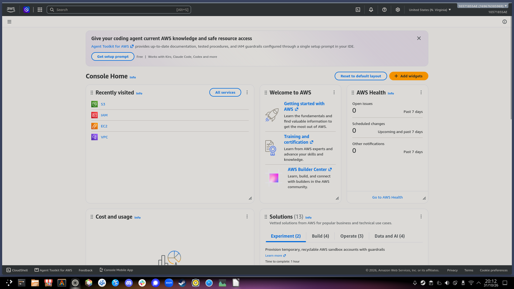
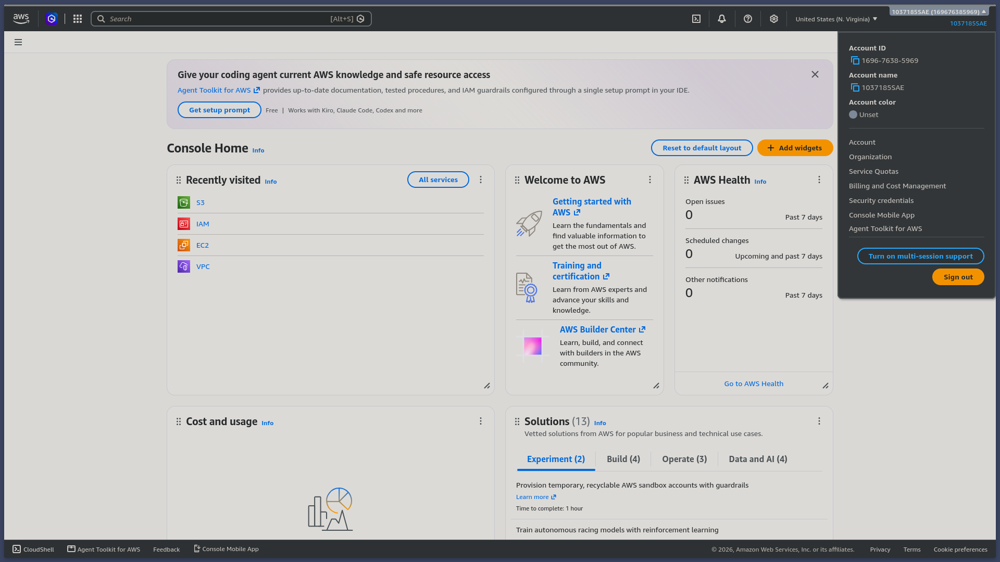

# AWS_S3_Storage_Demo
A simple demo showing how AWS S3 buckets can be used in a desktop manner.

## Compiling and Running
To compile this program, you will need to have followed the step-by-step guide to set up the infrastructure on AWS' end. If not, follow the submitted PDF to do so.

You will also need to clone this repository. To do that, go into a folder you want this repo to live in, and run the following command:

```sh
git clone https://github.com/1037185SAE/AWS_S3_Storage_Demo.git
```

Once that is done, you will need the rust toolchain to compile it. If not, go to https://rust-lang.org/tools/install/, and follow the instructions there.

Afterwards, open a terminal, navigate to the folder with the cloned repo inside, and simply run the command:

```sh
cargo build --release
```

The resulting binary will then be available in the folder `target/release`.

If you wish to compile with debug symbols enabled, simply omit the --release flag:

```sh
cargo build
```

When compiling with debug, the binary will instead be placed in `target/debug`.

Please keep in mind that if compiling with debug symbols enabled, the UI will have extra debug information present, and the resulting binary will be **much** bigger (300+ MB as opposed to <10MB, from experience).

If at any point you wish to rebuild everything, or clear the hundreds of megabytes of used space that rust is known for, simply run the command:

```sh
cargo clean
```

In the folder, and the cached data will be deleted.

You will need to run the program from the terminal, as it will ask for some credentials relating to your AWS account and IAM user:

1. Allocated Folder: The folder you have the IAM user access to
2. Bucket Name: The name you gave the bucket
3. Account ID: The id of your AWS root account (I will go into how to get that soon)
4. Access Key: The first part of the access key you created for you IAM user
5. Secret Access Key: The second part of the access key you created (It will not echo characters as you type or paste it in)
6. Default Region: The region you created the bucket in

These credentials are stored in memory, discarded when the program exits, and aren't written to any files.

## Getting the required info

### Account ID

To access the account ID, go to the main menu of the AWS console.



Look in the very top right, and you will see a gray drop-down with your account name and ID. Click that, and it will show your ID, and a button to copy it to the clipboard. You can then paste it into the terminal.

